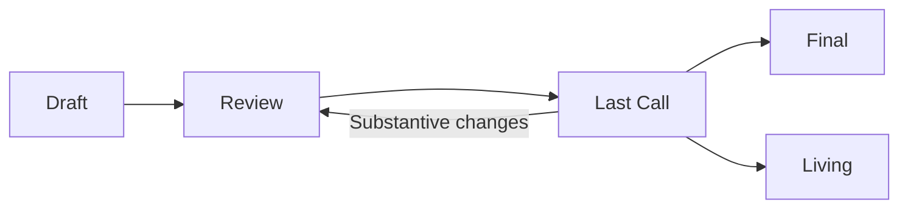

# OIP-1: OIP Purpose and Guidelines

## Abstract

A ONEchain Improvement Proposal (OIP) records a proposed change to the ONEchain protocol, a shared client interface, or a development process.
This document defines proposal types, submission requirements, review stages, and editorial responsibilities.
Application-level standards are recorded separately as ORCs and use the same process with the conventions defined below.
It also separates publication of a specification from decisions to implement or activate it.
This is a Living document that defines the repository's proposal process and is maintained as that process evolves.

## Motivation

Protocol changes and shared interfaces need a durable explanation of what changes, why it changes, and how independent implementations can agree on the result.
Issues and implementation pull requests help develop an idea, but their discussions alone do not provide a stable specification.
OIPs bring the specification, alternatives, compatibility analysis, and review record into a versioned repository.

## Specification

The uppercase terms MUST, MUST NOT, SHOULD, SHOULD NOT, and MAY express requirement levels as defined in [RFC 2119](https://www.rfc-editor.org/rfc/rfc2119) and [RFC 8174](https://www.rfc-editor.org/rfc/rfc8174).

### Scope

An OIP SHOULD address one coherent change that affects shared behavior, interoperability, or a community process.
Relevant subjects include consensus rules, execution behavior, protocol-level system contracts, validator and staking mechanisms, networking, and client APIs.
Application-level standards, including token interfaces, wallet conventions, and contract interoperability, MUST be managed separately as ORCs (ONEchain Requests for Comments).
Routine bug fixes that preserve the existing specification, internal refactoring, and product-specific features SHOULD be handled in their implementation repositories.
Related changes MAY use separate OIPs with explicit dependencies.

### Proposal Types and Categories

Each OIP MUST declare one of the following types.

| Type | Scope |
| --- | --- |
| Standards Track | A specification of behavior shared by protocol implementations, clients, or their external interfaces. |
| Meta | A proposal about development, coordination, governance processes, or the OIP process itself. |
| Informational | Explanatory material or guidance that does not establish a required standard or imply community agreement. |

A Standards Track OIP MUST also declare one category.
Other types MUST omit the category field.

| Category | Scope |
| --- | --- |
| Core | Consensus, block and transaction validity, execution rules, protocol economics, and protocol-level system contract behavior. |
| Networking | Peer discovery, peer-to-peer messages, transport, and synchronization protocols. |
| Interface | Shared external interfaces such as RPC methods, APIs, and data formats used by clients and tools. |

The primary effect of a proposal determines its category.
A change to consensus rules MUST use Core even if it also changes an API or system contract interface.
Application-level conventions belong to ORCs even when they define interfaces used by wallets or contracts.

### Application Standards (ORCs)

ORCs are maintained in the [ORCs directory and index](../ORCs/README.md).
They follow the submission, review, lifecycle, and maintenance requirements in this document with these differences:

- Authors MUST use the [ORC template](../templates/orc-template.md) and submit drafts as `ORCs/orc-draft-<short-title>.md`.
- Editors assign ORC numbers independently of OIP numbers, starting at 1. Before merge, the file MUST be renamed to `ORCs/orc-N.md` and added to the ORC index.
- The metadata MUST use `orc` instead of `oip`, with `TBD` before assignment and the assigned number before merge. The heading MUST use `ORC-N` instead of `OIP-N`.
- ORCs MUST use `type: Standards Track` and omit `category`, since their application-level scope is defined by the ORC namespace.
- In an ORC, `requires` lists ORC numbers. Dependencies on OIPs MUST be identified and linked in the Specification rather than placed in that field.
- Attachments MUST use `assets/orc-N/`, or `assets/orc-draft-<short-title>/` before assignment, and their links MUST be updated when the number is assigned.

References to an ORC MUST use `ORC-N` and a relative Markdown link on first mention.
For example, an OIP refers to an ORC at `../ORCs/orc-N.md`, and an ORC refers to an OIP at `../OIPs/oip-N.md`.
A proposal spanning protocol changes and application conventions SHOULD be split into linked OIP and ORC documents.
This document provides the shared process; a separate ORC process proposal is not required.

### Participants and Decision Authority

The development team primarily authors and maintains OIPs and ORCs.

- **Authors** maintain the proposal, solicit review, respond to objections, and document unresolved concerns and alternatives.
- **Editors** check scope, clarity, formatting, numbering, and compliance with the process, then merge eligible changes.
- **Reviewers** evaluate technical correctness, compatibility, security, and the evidence supporting a status transition.
- **Implementers and affected participants** assess adoption and deployment in the relevant client, contract, validator, tool, or application context.

Initially, repository maintainers with merge access perform the editor role.
Changes to editor responsibilities SHOULD be documented publicly through a repository pull request.
Editors MUST NOT treat assigning a number or merging a Draft as technical approval or network authorization.
An editor's merge permission does not grant authority to activate a protocol change.

### Submission and Numbering

1. The author SHOULD first discuss the problem publicly and check for related proposals.
2. The author MUST prepare a Markdown document using the [proposal template](../templates/oip-template.md) and submit it by pull request.
3. Before assignment, the filename MUST be `OIPs/oip-draft-<short-title>.md` and the number MUST be `TBD`.
4. An editor MUST check that the draft has a meaningful specification, required metadata and sections, and enough context for review.
5. The editor assigns the next unused positive integer, taking published proposals and all prior assignments into account; OIP-1 is reserved for this process document.
6. Before merge, the author MUST rename the file to `OIPs/oip-N.md`, replace `TBD` with the assigned number, update the heading and asset paths, and add the proposal to the [README index](../README.md#proposals).

OIP numbers are independent of issue and pull request numbers.
Once assigned, a number MUST NOT be reused or reassigned to an unrelated proposal, including when its submission closes without merging.
Published proposals MUST retain their number and file path; withdrawn and superseded documents remain available as historical records.

A draft MAY use its submission pull request for initial discussion.
Before entering Review, it MUST identify a public, durable discussion thread in `discussions-to`, normally a [repository issue](https://github.com/to-nexus/OIPs/issues).
Discussion references MUST point to a specific thread rather than a repository, issue list, or chat homepage.
Existing deployed behavior MAY instead be registered directly as Final under [Documenting Existing Deployed Behavior](#documenting-existing-deployed-behavior).

### Proposal Lifecycle

An idea discussed before submission has no document status.
The usual publication path is:

The diagram shows the primary path; the table and rules below also govern inactivity, withdrawal, and resumption.

| Status | Meaning and entry requirement |
| --- | --- |
| Draft | A published work in progress that is suitable for discussion but may have unresolved design questions. |
| Review | The author considers the specification complete enough for technical review and has provided a public discussion thread. |
| Last Call | Review has produced a stable specification; an editor announces a final public review period and records its deadline. |
| Final | A stable specification that meets the requirements below after the usual review period or retrospective registration of existing deployed behavior. Deployment facts are recorded separately. |
| Living | A Meta or Informational document adopted after review for continued maintenance rather than a fixed final specification. |
| Stagnant | An unfinished proposal has had no substantive progress for at least six months and an editor has notified the author and recorded the change. |
| Withdrawn | The author has ended an unfinished proposal and documented the reason. The same number cannot be revived. |

Authors request status changes through pull requests, and editors verify their evidence before merging.
The corresponding README row MUST change in the same pull request.
The status transition and its reasons MUST remain visible in the pull request history.

#### Review and Last Call

A Review proposal MUST provide a complete Specification and meaningful compatibility and security analysis.
An editor MAY move it to Last Call when the author requests it and the review record addresses material objections.
The Last Call announcement MUST link the proposal and discussion, state whether the intended destination is Final or Living, and allow at least 14 days for public review.
The `last-call-deadline` date MUST be at least 14 calendar days after the announcement; the window ends at 23:59:59 UTC on that date.

Changes to requirements or behavior during Last Call MUST return the proposal to Review.
After those changes are reviewed, a new Last Call MUST provide another full review period.
Editorial corrections that preserve meaning MAY be made without restarting Last Call.
Returning to Review or leaving Last Call MUST remove the `last-call-deadline` field; past deadlines remain in Git history.

#### Final and Living

Under the usual lifecycle, an editor MAY merge a transition from Last Call to Final or Living only after the deadline has passed and the author has recorded the review outcome.
That record MUST summarize technical support, material objections and their resolution, and remaining limitations.
Unresolved objections about correctness, compatibility, or security MUST be addressed before advancement; silence alone is not evidence of agreement.
Status-only transitions SHOULD be separate from specification changes.

A Standards Track OIP MUST include implementation and test evidence before becoming Final.
Consensus changes MUST include reproducible tests covering activation boundaries, valid and invalid cases, and relevant compatibility behavior, together with review by affected implementation maintainers.
Required dependencies MUST be Final or, for applicable process dependencies, Living before a dependent proposal becomes Final or Living.
A Meta proposal MUST record agreement from the maintainers or participants responsible for the affected process before becoming Final or Living.
Informational proposals require review for accuracy and clarity; their status does not make their advice mandatory.

A Final OIP MUST NOT change its requirements or behavior in place.
Corrections and clarifications that preserve meaning MAY be merged; a behavioral revision requires a new OIP that identifies the prior proposal and explains the change.
A Living OIP MAY be maintained in place, but substantive changes MUST receive at least 14 days of public review and a recorded decision in the change pull request.
Its status remains Living during that review.

As the initial process document, OIP-1 starts in Living without a prior Last Call or a `discussions-to` thread.
Subsequent proposals follow the usual lifecycle or the retrospective registration path below.
Later substantive revisions to OIP-1 follow the Living-document review rules.

#### Documenting Existing Deployed Behavior

An OIP that documents behavior already implemented and in use on a live network, service, or application MAY be initially registered as Final.
This retrospective registration MUST describe existing behavior without introducing new protocol rules, interface requirements, or activation decisions.

The document MUST identify the applicable networks or components, the behavior being documented, and the implementation revision or release used as its reference.
It MUST provide evidence of agreement between the specification and implementation, using existing tests, reproducible vectors, or recorded runtime checks, with their verification limits stated.
The Implementation and Activation section MUST distinguish confirmed operational facts from source defaults and unverified deployment details.
The first activation block, date, or release MAY remain unverified when historical evidence is unavailable; source defaults MUST NOT be presented as proof of historical activation.

The author and editor MUST confirm the document's accuracy against the existing behavior and resolve material specification ambiguities or implementation mismatches before registration.
The submission pull request MUST identify this registration path and summarize its supporting evidence and remaining verification limits.

Retrospective registration does not require historical adoption approvals or review records, a separate discussion thread, the Review and Last Call stages, or a `discussions-to` field.
An existing discussion thread SHOULD be linked when available.
Requirements for a complete specification, implementation and test evidence, and finalized dependencies still apply.
Registration does not itself approve a new deployment or establish that every implementation path has been tested.

Proposed behavior changes MUST follow the usual lifecycle in a separate proposal.
Once registered, the specification follows the same maintenance rules as every other Final OIP.

#### Inactivity, Withdrawal, and Ownership

An editor MAY mark a Draft, Review, or Last Call proposal Stagnant after six months without substantive progress, with notice to the author in a public issue or pull request.
An author MAY resume a Stagnant proposal as Draft or Review through a pull request with a progress update.
A resumed proposal MUST pass a new Last Call before Final or Living.
An author MAY return a Review proposal to Draft when further design work is needed.

An author MAY withdraw a Draft, Review, Last Call, or Stagnant proposal by providing a `withdrawal-reason`.
A later revival of a Withdrawn proposal requires a new number and a reference to the earlier document.
Final and Living documents are not withdrawn through this path; a replacement or retirement decision MUST preserve the original record and explain the relationship in a linked proposal.

Ownership changes MUST be documented in a pull request and normally require the current author's agreement.
If the author is unreachable, an editor MAY approve a transfer after documented contact attempts and a public notice period of at least 14 days.
The transfer MUST preserve original authorship credit and identify the new responsible maintainer.
Disagreement with an available author is a reason to propose an alternative, not to take over their document.

### Document Format

OIPs MUST use UTF-8 Markdown, English prose, and a metadata block delimited by `---` at the start of the file.
Metadata uses YAML-compatible `key: value` lines; values containing YAML punctuation SHOULD be quoted.
Fields MUST appear in the following order when applicable.

| Field | Requirement |
| --- | --- |
| `oip` | Assigned positive integer; `TBD` only in a submission awaiting assignment. |
| `title` | A concise descriptive title without the OIP number. |
| `description` | One short sentence summarizing the proposal. |
| `author` | Names or team names; GitHub handles or email addresses may be included. The submission must identify a responsive GitHub participant responsible for updates. |
| `discussions-to` | A specific public discussion URL; required from Review onward except for the initial publication of OIP-1 and retrospective Final registration under [Documenting Existing Deployed Behavior](#documenting-existing-deployed-behavior). Retained on later inactivity or withdrawal. |
| `status` | One of the statuses defined above. |
| `last-call-deadline` | Required only in Last Call, as a `YYYY-MM-DD` date. |
| `type` | Standards Track, Meta, or Informational. |
| `category` | Required for Standards Track OIPs: Core, Networking, or Interface. Omitted for ORCs. |
| `created` | First submission date as `YYYY-MM-DD`; not changed on later revisions. |
| `requires` | Comma-separated OIP numbers when other proposals are necessary to understand or implement this one; otherwise omitted. |
| `withdrawal-reason` | Required only for Withdrawn; a brief explanation of why work ended. |

The document MUST have a heading of the form `# OIP-N: Title` after its metadata.
Before number assignment, the heading MAY use `OIP-TBD`.
Dependencies MUST NOT include the proposal itself or form a cycle.
An OIP's `requires` field lists only OIP numbers; an ORC's lists only ORC numbers.
Dependencies across these namespaces MUST be identified and linked in the Specification.
External EIPs and BEPs are cited in the text and do not use `requires`.

The following sections MUST appear in order; conditionally required and optional sections are included where applicable.

| Section | Requirement |
| --- | --- |
| Abstract | Required. A short explanation of the change and its scope. |
| Motivation | Required. The problem and why the proposal is needed. |
| Specification | Required. Precise behavior, requirements, and assumptions sufficient for independent implementations or process participants. |
| Rationale | Required. Reasons for the design, alternatives, and significant objections. |
| Backwards Compatibility | Required. Affected existing behavior, migration needs, and interaction with known planned changes, or an explicit explanation of why none applies. |
| Test Cases | Required for Standards Track before Final and for consensus proposals by Review. Include inputs, expected results, or reproducible test references. Optional for other types. |
| Reference Implementation | Optional. Implementation links or examples that help explain the specification. |
| Implementation and Activation | Required for changes needing coordinated deployment or process adoption, and for retrospective Final registration. Record applicable plans, open decisions, existing behavior, and supporting evidence. |
| Security Considerations | Required. Threats, trust assumptions, failure modes, mitigations, and unresolved risks. |
| References | Optional. Related proposals and supporting sources. |
| Copyright | Required. Include the CC0 dedication below. |

Drafts MAY identify unfinished work explicitly, but MUST contain a substantive proposal rather than an unfilled template.
Required review and finalization evidence MUST be supplied before the corresponding transition.
An implementation link MUST NOT substitute for a specification of the required behavior.

### Implementation and Activation Records

Document status and network deployment are separate facts.
For changes needing coordinated deployment, the Implementation and Activation section MUST distinguish planned, implemented, tested, and activated work using evidence rather than assumptions.
It MUST identify affected networks and components, implementation or release references, dependencies, and the activation mechanism when known.
Unknown details MUST be marked as undecided rather than expressed as confirmed schedules.

For protocol changes, this section MUST record required coordination with implementers and operators and link any applicable governance decision.
This process does not define ONEchain's voting mechanism, voting thresholds, or upgrade authorities.
Activation MUST follow the applicable network or system governance and deployment process; a document merge or Final status cannot replace it.
For new activations, the record MUST identify the network and the actual block, timestamp, release, or other activation condition, with supporting evidence.
Retrospective specifications record known operational facts and may leave historical activation details unverified under [Documenting Existing Deployed Behavior](#documenting-existing-deployed-behavior).

### Links, Assets, and Maintenance

References to other OIPs MUST use `OIP-N` and a relative Markdown link on first mention.
Attachments MUST be stored under `assets/oip-N/` and referenced using paths such as `../assets/oip-N/diagram.svg` from the proposal.
Images MUST include meaningful alternative text.
Temporary draft asset directories MUST be renamed when a number is assigned.

External references SHOULD use stable, publicly readable URLs.
Implementation and test evidence SHOULD link to a commit or release rather than a moving branch.
Authors MUST only contribute material they can make available under the repository's CC0 terms.
The relevant proposal index MUST be kept consistent with proposal metadata in each pull request: the root README for OIPs and the ORCs README for ORCs.

## Rationale

The document format and editorial stages follow the general approach of EIP-1, while the repository index and explicit attention to implementation and activation draw on BEP-1.
The process uses Meta for process proposals and keeps application-level standards in ORCs so that their scope is distinct from protocol and client changes.
Sequential editor-assigned numbers avoid coupling proposal identifiers to unrelated issue or pull request activity.

Final describes specification stability; deployment evidence is recorded separately so readers can distinguish an accepted design from behavior available on a particular network.
A 14-day Last Call provides a predictable minimum review period, while Living supports ongoing maintenance of process documents.
GitHub issues and pull requests provide an initial discussion and review venue without requiring a separate forum or publishing system.
The proposal does not import Ethereum's core developer procedures or BNB Chain's governance rules as ONEchain policy.

Retrospective registration lets the repository document stable behavior that was already in use before its specification was submitted.
Implementation evidence and a check of the document's accuracy support that registration without requiring historical approval records to be reconstructed.

## Backwards Compatibility

This proposal introduces a documentation process and does not change block validity, transactions, contracts, or existing APIs.
It does not retroactively assign OIP numbers or adoption status to existing ONEchain features.
Later proposals documenting existing behavior should clearly distinguish that behavior from newly proposed requirements.

## Implementation and Activation

The initial repository provides separate OIP and ORC directories, indexes, and submission templates, together with shared GitHub review templates.
OIP-1 establishes the initial proposal management process as a Living document.
This process does not require a network fork or contract deployment.

## Security Considerations

Ambiguous requirements or treating a merged document as deployment approval can lead to incompatible implementations or unsafe upgrades.
Separating editorial decisions from adoption, requiring compatibility and security analysis, and recording implementation evidence reduce those risks.
Protocol reviewers should pay particular attention to activation boundaries, malformed inputs, denial of service, privileged operations, and effects on user funds.

Repository write access permits changes to the published record, so review decisions and authorship changes need public, auditable history.
External references can change or disappear; commit-specific evidence and local supporting assets help preserve reviewability.
Publication and Final status do not establish that an implementation has been audited or is free of vulnerabilities.

## References

The following source revisions were consulted on 2026-10-28:

- [EIP-1: EIP Purpose and Guidelines](https://github.com/ethereum/EIPs/blob/d4c575521d99ec881a444ab3af604e684b5f0743/EIPS/eip-1.md).
- [BEP-1: Purpose and Guidelines](https://github.com/bnb-chain/BEPs/blob/7d2c2f723b0fcdf2e17312b4faa0123447ce9b74/BEPs/BEP1.md).

## Copyright

Copyright and related rights waived via [CC0](../LICENSE.md).
