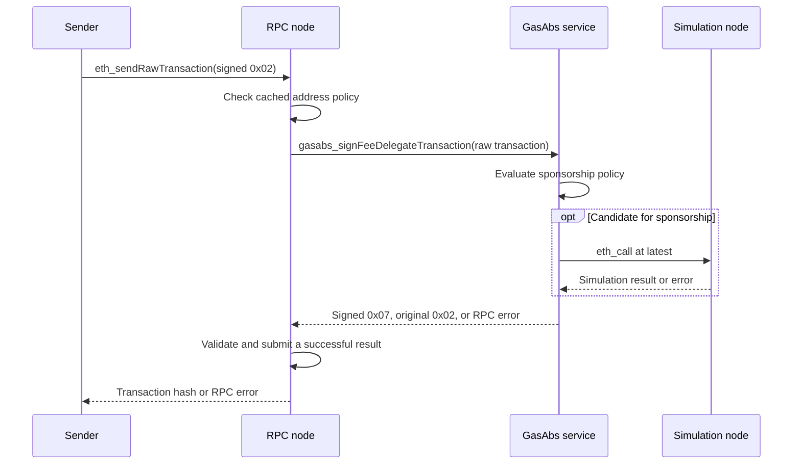

# OIP-16: Gas Abstraction Sponsorship Service

## Abstract

This proposal describes the GasAbs interface between a ONEchain RPC node and an optional fee sponsorship service.
The service evaluates a sender-signed dynamic fee transaction and either returns an authorized fee-delegated wrapper, returns the original transaction without sponsorship, or reports an error.
It also publishes address eligibility lists used by the node before requesting sponsorship.

The transaction format and payer authorization are defined by [OIP-2](oip-2.md).
GasAbs is an optional submission service; its availability and sponsorship policies are not consensus validity requirements.

## Motivation

Applications can obtain a sender's ordinary transaction signature before arranging payment of its gas by another account.
A shared service interface lets RPC nodes request that authorization without holding the sponsor's private key or duplicating all sponsorship rules.

Eligibility, successful simulation, payer authorization, pool admission, and inclusion are separate outcomes.
In particular, a successful GasAbs RPC response can contain an ordinary sender-funded transaction.
Documenting these distinctions avoids treating every successful submission as a promise that someone else will pay.

## Specification

### Scope and Participants

The sender signs a type `0x02` transaction, including its chain ID, nonce, fee caps, gas limit, destination, value, calldata, and access list.
The RPC node evaluates cached address eligibility and, when appropriate, forwards that signed transaction to GasAbs.
The service applies its own policy and may authorize payment using its fee payer key.
The node then submits the returned transaction through normal validation and pool admission.



The diagram shows an eligible raw submission; locally blocked transactions stop before contacting the service, and non-eligible transactions continue without a signing request.
[OIP-13](oip-13.md) defines transaction and receipt query representations.
This proposal does not add payer fields to transaction-construction or gas-estimation arguments.

### RPC Methods

Requests and responses use [JSON-RPC 2.0](https://www.jsonrpc.org/specification), with positional parameters and case-sensitive method names.
Addresses are 20-byte hexadecimal data, versions are 32-byte hexadecimal data, and serialized transactions are hexadecimal byte strings, all with a `0x` prefix.

| Method | Parameters | Successful result |
| --- | --- | --- |
| `gasabs_accessList` | `[knownVersion]` | Address-policy object described below. |
| `gasabs_accesslist` | `[knownVersion]` | Compatibility alias with the same semantics. |
| `gasabs_signFeeDelegateTransaction` | `[signedRawTransaction]` | Serialized sponsored wrapper or unchanged original transaction. |
| `gasabs_isApprovedFrom` | `[address]` | Boolean membership in the sender whitelist. |
| `gasabs_isApprovedTo` | `[address]` | Boolean membership in the destination whitelist. |

The pinned go-cross client calls the lowercase-`l` alias `gasabs_accesslist`; compatible services MUST support that spelling.
The reference service supports both spellings.
The approval queries report membership only and MUST NOT be interpreted as a complete sponsorship decision.
They do not test transaction type, method restrictions, fee limits, simulation, or all blacklist conditions.

### Address-Policy Synchronization

The policy object contains these fields:

| Field | Meaning |
| --- | --- |
| `version` | Opaque version token for the published policy snapshot. |
| `whitelist_from` | Sender addresses eligible to request sponsorship. |
| `whitelist_to` | Destination addresses eligible to request sponsorship. |
| `blacklist_from` | Sender addresses rejected by the node's GasAbs submission policy. |
| `blacklist_to` | Destination addresses rejected by that policy. |

These lists are service policy data and are unrelated to the EVM access list inside a transaction.
Array order has no meaning, and duplicate addresses do not add eligibility.
Method selectors and other detailed sponsorship rules are not included in this response.

A client starts with the all-zero version and empty lists.
If the returned version differs from its cached version, it MUST replace all four lists with the returned snapshot rather than merge them.
If the version is unchanged, it MUST retain its cached lists.
The reference service returns an object with the current version and four `null` list fields for an unchanged version; it does not return a top-level `null` result.

Example unchanged response:

```json
{
  "jsonrpc": "2.0",
  "id": 1,
  "result": {
    "version": "0x0000000000000000000000000000000000000000000000000000000000000001",
    "whitelist_from": null,
    "whitelist_to": null,
    "blacklist_from": null,
    "blacklist_to": null
  }
}
```

The version is a cache token, not a signature, approval receipt, or proof that the node and service have identical policy at submission time.
Service policy may change between synchronization and a signing request.

### Node Eligibility and Submission

For a decoded transaction, let `from` be its recovered sender and let `to` be its destination, using the zero address for contract creation.
When a GasAbs client is enabled, the reference submission path applies these rules in order:

1. Recover the sender. An invalid signature stops submission.
2. Reject if `from` is in `blacklist_from` or `to` is in `blacklist_to`.
3. Request sponsorship only if the transaction is type `0x02` and either address is in its corresponding whitelist.
4. Otherwise, continue with the submitted transaction unchanged.

Blacklist rejection takes precedence over whitelist eligibility and applies to other transaction types, including an already signed type `0x07` wrapper.
An existing wrapper is not automatically re-signed.
These checks affect this RPC submission path; they are not block-validity or network-wide transaction bans.

For an eligible request, the node MUST distinguish all three service outcomes:

| Outcome | Submission behavior |
| --- | --- |
| Sponsored type `0x07` | Validate the payer authorization and apply normal admission checks. |
| Original type `0x02` | Apply ordinary sender-funded admission checks. |
| RPC, transport, or decoding error | Stop this submission attempt and return an error. |

A service error MUST NOT be converted locally into a successful sponsorship result or an automatic submission of the original transaction.
An original transaction returned in a successful response is a separate policy outcome, not an error fallback.
Neither kind of successful service response bypasses the node's fee limits or pool rules.

The reference client applies this integration to `eth_sendRawTransaction` and `eth_sendRawTransactionSync`.
Without a GasAbs client, those methods use ordinary submission.
`eth_sendTransaction`, `eth_fillTransaction`, `eth_signTransaction`, `eth_call`, and `eth_estimateGas` do not obtain sponsorship through this integration.

### Signing Request and Response

`gasabs_signFeeDelegateTransaction` takes one fully sender-signed type `0x02` transaction.
The service MUST reject malformed encodings, invalid sender signatures, and unsupported transaction types rather than treating them as unsigned signing requests.

For a sponsored result, it MUST preserve the complete signed inner transaction and return the type `0x07` wrapper defined by OIP-2 with the selected payer address and valid payer signature.
For an unsponsored successful result, it MUST return the original transaction unchanged.
The result is raw transaction data, not a transaction hash or JSON transaction object.
The method does not broadcast the transaction or wait for inclusion.

Both successful results share the original transaction hash under OIP-2.
A caller MUST inspect the returned transaction type and payer authorization to determine whether sponsorship was obtained; a matching hash or a successful RPC status is insufficient.
Callers SHOULD also compare the returned signed inner transaction with the submitted transaction before forwarding the result.
The pinned node decodes the response and applies normal submission checks, but does not explicitly compare the response with the original request inside its GasAbs adapter.

The interface does not reserve a sender nonce, reserve sponsor funds, or add an expiration to the payer signature.
Errors use the normal JSON-RPC error response; this proposal does not standardize numeric GasAbs error codes or require exact message text.

### Reference Service Policy

The following describes the pinned service implementation, not mandatory sponsorship criteria for every provider.
Providers may choose different eligible applications, methods, budgets, or simulation policies without changing OIP-2.

The service evaluates the recovered sender first.
A sender in `whitelist_from` skips destination method filtering, but still passes through the tip-cap and simulation checks.
Otherwise, the destination must be in `whitelist_to`, and its configured method policy applies.
For creation, the destination used for policy lookup is the zero address; the simulation still uses a missing destination to represent creation.

| Destination policy | Reference behavior |
| --- | --- |
| All methods allowed | Continue toward sponsorship, including for empty calldata. |
| Selector list configured and the first four calldata bytes match | Continue toward sponsorship. |
| Selector missing, calldata shorter than four bytes, or selector not listed | Return the original transaction successfully. |
| Filtered `approve(address,uint256)` call | Decode the arguments and require the spender to be in `whitelist_to`; otherwise return the original transaction. |

The special spender check applies when `approve` is evaluated through a selector filter; sender-whitelisted and destination-all-methods paths bypass that filter.
An approved destination missing from the method-filter map is treated as allowing all methods by the reference filter.
An address absent from both relevant whitelists is rejected rather than receiving a successful bypass result.

For a sponsorship candidate, `maxPriorityFeePerGas` must be less than or equal to the configured `max_tip_cap`, converted from Gwei to wei.
This is a tip limit, not a cap on total gas expenditure or a reservation against the payer's balance.

Before signing, the service calls its configured execution node's `eth_call` at `latest`, using the recovered sender, original destination, gas limit, value, and calldata.
It does not copy the transaction's nonce, chain ID, fee caps, access list, or payer authorization into that call.
The call is therefore a preliminary simulation, not execution of the complete signed wrapper.
A node-state mismatch, insufficient value balance, call revert, or other RPC error can prevent sponsorship even when another endpoint would accept the transaction.
The request's chain ID is used for signing, but the handler does not independently compare it with the simulation node's chain ID.

The signing handler does not independently enforce the exported blacklists.
The node's cached checks are part of the intended submission route; directly exposing the signing API does not provide equivalent blacklist enforcement.

### Reference Retry Behavior

For selected policy failures, including excessive tip cap and failed simulation, the service uses a Redis marker keyed by the original transaction hash:

1. If deleting the marker reports that no marker existed, store one with the configured TTL and return the policy error.
2. If an existing marker was deleted, return the original transaction successfully without a payer signature.

The default marker TTL is 30 seconds.
Under a persistent failure and a functioning cache, sequential retries can alternate between an error and an unsponsored successful response while markers remain available.
The marker is not a cache of successful sponsorship, and it does not cancel an already signed wrapper.
Malformed requests, invalid sender signatures, missing signing keys, and unapproved addresses do not use this retry bypass.
Immediate method-policy bypass also does not require a prior error.

Clients MUST NOT assume retrying an identical raw submission preserves the gas payer outcome.
If only sponsored execution is acceptable, a workflow must inspect the signed result before broadcasting; the automatic raw-submission route does not provide a sponsorship-only flag.
Cache failures and concurrent requests can affect marker behavior, so it is not an exactly-once or idempotency guarantee.

## Rationale

Address synchronization avoids contacting the signing service for every raw transaction, while detailed method and simulation checks remain on the service.
Returning serialized transactions lets the node reuse its normal validation path for both sponsored and unsponsored results.
The three-outcome model describes the existing distinction between sponsorship, ordinary submission, and rejection.

The interface is separate from Core transaction validity and from transaction-query representations because sponsorship availability and provider policy can evolve independently.
The policy and retry sections document the reference service without making its database, cache, application selectors, or numerical limits consensus requirements.

## Backwards Compatibility

Services supporting the pinned node must retain `gasabs_accesslist` even if they prefer the `gasabs_accessList` spelling.
The reference service also exposes a deprecated `gasabs_whitelist` method with only `version`, `from`, and `to`; it cannot replace the four-list interface for clients enforcing blacklist policy.

An unchanged-version response must not erase the client's cached lists.
Clients must accept a successful original-transaction response without mislabeling it as sponsored.
Existing independently signed wrappers remain valid without GasAbs, subject to OIP-2 and the receiving node's admission policy.
No new transaction type, receipt field, or consensus fork is introduced.

## Test Cases

The following cases define the expected interface behavior or, where identified, the reference service policy.

| Case | Expected result |
| --- | --- |
| Request either supported access-list spelling with an old version | Return the current version and the full four-list snapshot. |
| Request with the current version | Return the same version with `null` lists; the client retains its snapshot. |
| Invalid sender signature in a raw submission | Error before service signing. |
| Address appears in both the node's whitelist and blacklist | Blacklist rejection wins. |
| Ordinary non-eligible transaction | No signing request; ordinary submission. |
| Eligible signed `0x02`, passing policy and simulation | Return a signed `0x07` preserving the original inner transaction and hash. |
| Direct request containing another transaction type | Service error. |
| Sender whitelisted, destination has a restrictive method filter | The reference service skips that method filter and proceeds to tip and simulation checks. |
| Destination whitelisted, selector not allowed | Return the original `0x02` successfully without simulation. |
| Filtered `approve` with a spender outside `whitelist_to` | Return the original transaction successfully. |
| Tip equals the configured maximum | Pass the reference tip-cap check. |
| Tip exceeds the maximum and no retry marker exists | Return an error and create a marker. |
| Repeat that failing request while the marker exists | Delete the marker and return the original transaction successfully. |
| Simulation returns an error | Apply the same reference marker behavior; do not sign a wrapper. |
| Neither sender nor destination is approved | Error on repeated requests; no marker-based bypass. |
| Service returns an RPC error or undecodable bytes | Node submission stops for that attempt. |
| Service returns the original transaction successfully | Normal sender-funded validation applies; insufficient sender funds may still reject it. |
| Direct request with an approved sender and a blacklisted destination | The pinned signing handler can still sign; blacklist enforcement belongs to the node path. |

The simulation case should verify that the request uses `latest` and contains the original `from`, `to`, `gas`, `value`, and calldata, without the omitted transaction fields listed above.
Testing must distinguish mock-backed policy execution from actual pool admission and network inclusion.

## Reference Implementation

The reference revisions are [go-cross `4c0838f`](https://github.com/to-nexus/go-cross/commit/4c0838f828f3a6300a1bd09fc70fec474a07a156) and [gasabs `f5e0af7`](https://github.com/to-nexus/gasabs/commit/f5e0af72bf0ce283015974011783df62f57dd8a0).

- [Node service client and cached eligibility checks](https://github.com/to-nexus/go-cross/blob/4c0838f828f3a6300a1bd09fc70fec474a07a156/internal/ethapi/gasabs/client.go).
- [Service RPC handlers, policy, simulation, and signing](https://github.com/to-nexus/gasabs/blob/f5e0af72bf0ce283015974011783df62f57dd8a0/internal/gasabs/api.go).
- [Destination method and approval-spender filtering](https://github.com/to-nexus/gasabs/blob/f5e0af72bf0ce283015974011783df62f57dd8a0/internal/gasabs/filter/filter.go).

Implementation checks and their scope are recorded in the separate [verification record](../assets/oip-16/verification.md).

## Implementation and Activation

The reviewed node revision is the local `go-cross/main` snapshot; the service revision is the local snapshot of its default branch, `origin/dev`.
The service's `origin/master` snapshot adds a production SQL migration but has the same signing and filter code.
The reviewed service depends on go-cross `v1.1.2`; it is not built against the newer node revision cited above.
These source snapshots are not proof of the versions deployed at any endpoint.

Node integration is enabled through `GasAbsURL`.
The reference node starts policy synchronization asynchronously, then refreshes about every 30 seconds, retaining the last cached snapshot on refresh errors.
Before the first successful synchronization, the empty lists can allow ordinary sender-funded submission.
If client construction fails and leaves the integration unset, submission also continues without GasAbs.

The reference service loads address and method policy from MySQL and checks its version about every second.
It uses Redis for retry markers and a configured keystore for payer signing.
Those components and refresh intervals are implementation choices, not required parts of the wire interface.
Node and service configuration, payer funding, chain alignment, access controls, and receipt consumers require coordinated operational validation; no new consensus activation is scheduled.

## Security Considerations

A successful RPC result does not guarantee sponsorship, pool admission, inclusion, or successful execution.
Applications must distinguish the returned transaction variant and the included receipt's actual payer.
Automatic retries can result in sender-funded submission under the reference policy even when the previous attempt returned a sponsorship error.

The service receives an already valid ordinary sender signature and returns a reusable payer authorization when it sponsors.
OIP-2's nonce, signature, and replay considerations apply; the Redis TTL does not limit that authorization's validity.
The reference handler does not reserve aggregate sponsor funds or impose a total-cost budget, so a tip cap alone does not bound concurrent sponsorship exposure.

The RPC node trusts an external service response beyond merely decoding it.
Implementations should verify the response's transaction identity, chain, and payer authorization, and protect the configured endpoint and signing key.
The reference adapter's lack of an explicit request/response identity comparison must not be mistaken for such a check.

Cached policy may be stale, and the service's direct signing path does not enforce the node's blacklists.
Approval membership is not a complete authorization result; an approved sender also bypasses destination method restrictions in the reference policy.
Operators must account for these boundaries when exposing the service and granting whitelist entries.

Simulation depends on an external node's latest state and omits some signed transaction fields.
It cannot prove future execution success, funding, or agreement with the submitting node's chain.
Publishing this proposal does not establish an audit or safe operation of a particular service deployment.

## Copyright

Copyright and related rights waived via [CC0](../LICENSE.md).
